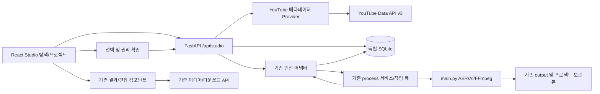

# AI Shorts Studio — P0 분석 및 개발 계획

- 분석일: 2026-10-23 (한국 시간 기준)
- 분석 기준: `wmheo87/openshorts`, HEAD `5a56929fb59c257fdf42aa5fdf4d8a1f49b1bc86`
- 범위: 실제 소스 조사와 P1~P4 설계만 수행한다. 이 문서는 구현·배포 완료를 의미하지 않는다.
- 제외: 자동 업로드, TTS/더빙, 예약 게시, 결제 기능의 신규 개발 및 연결. 기존 기능은 삭제하지 않는다.

## 1. 결론과 근거 구분

**[확인]** 기존 Clip Generator는 URL/파일 입력, 권리 확인, 비동기 작업, 하이라이트 추출, 세로 리프레이밍, 자막, 편집, 미리보기, MP4/ZIP 다운로드를 이미 제공한다. 신규 제작 엔진을 만들기보다 이 경로를 연결하는 것이 적합하다.

**[확인]** 키워드 기반 영상 탐색에 해당하는 독립 검색 API·화면은 없다. 현재 URL 입력은 검색/채널/재생목록이 아니라 단일 영상을 요구한다. `cloud/autopilot.py`의 자동화 기능은 이번 범위와 라이선스가 달라 재사용 기반으로 삼지 않는다.

**[설계]** `studio/`에 영상 탐색·권리 기록·SQLite 프로젝트를 독립적으로 추가하고 `/api/studio/*`를 사용한다. 기존 `/api/process`, `/api/status/{job_id}`, 미디어 전달과 편집 경로를 어댑터로 재사용한다. 기본 모드는 `BILLING_ENABLED=0`인 단일 운영자 self-host다.

**[미검증]** 실제 YouTube 검색 API, 영상 다운로드, 유료/무료 AI API, 모델 추론, GPU 인코딩, Docker 이미지 빌드·전체 컨테이너 기동, Windows/macOS 실행은 이번 P0에서 실행하지 않았다. 아래의 구현 파일·테이블·API·성능 목표는 모두 제안이다.

## 2. 저장소 구조와 기술 스택

아래는 생성된 캐시·가상환경·node_modules를 제외한 주요 디렉터리다.

| 경로 | 실제 역할 및 근거 |
|---|---|
| 루트 Python 모듈 | `app.py` FastAPI API/큐/복구, `main.py` 작업별 영상 파이프라인 |
| `clip_selection.py`, `gemini_worker.py`, `llm_backend.py` | 후보 구간·구조화 AI 응답·OpenAI 호환 텍스트 모델 |
| `scene_detection.py`, `reframe_v2.py`, 레이아웃 관련 모듈 | 장면 검출, 얼굴/사람 추적, 세로 프레임 렌더링 |
| `subtitles.py`, `editor.py`, `hooks.py`, `recut.py`, `ffmpeg_utils.py` | 자막·효과·훅·재편집·FFmpeg 인코딩 |
| `yt_clients.py`, `quality_probe.py`, `security_utils.py` | 단일 영상 URL 검증, 다운로드 클라이언트, 품질/길이 확인, SSRF 방어 |
| `s3_uploader.py`, `media_auth.py`, `restoring_static.py`, `watermarked.py` | 선택적 스토리지, 미디어 인증·복원·전달 |
| `dashboard/src/` | React 앱, 컴포넌트, API 클라이언트, 인증 컨텍스트, 브라우저 Remotion |
| `dashboard/seo/`, `dashboard/tools/` | 빌드 시 SEO 페이지와 독립 무료 도구 |
| `remotion/`, `render-service/` | 별도 Remotion 컴포지션, TypeScript/Express 렌더 서버 |
| `cloud/`, `alembic/` | 선택적 상용 모드: 인증·PostgreSQL·R2 프로젝트·사용량·결제 등 |
| `cli/`, `integrations/`, `examples/`, `skills/` | CLI, 외부 연동 및 사용 예제 |
| `tests/`, `.github/workflows/` | Python 회귀 테스트, 백엔드 테스트 및 대시보드 빌드 CI |
| `fonts/`, `assets/`, `bin/` | 폰트/폰트 매핑, 에셋, FFmpeg 스레드 제한 래퍼 |
| `docs/architecture/`, `docs/compliance/`, `ops/` | 하위 시스템 문서, 권리/운영 관련 문서와 스크립트 |
| `uploads/`, `output/` | 런타임 원본·결과·JSON·복구 파일. 프로젝트 DB 자체가 아님 |

**[확인]** Python 3.11이 Docker/CI 기준이다. 백엔드는 FastAPI/Uvicorn, google-genai, yt-dlp, faster-whisper, PySceneDetect, OpenCV, Torch/Ultralytics/MediaPipe와 FFmpeg를 사용한다. `requirements.txt`는 대부분 버전을 고정하지만 yt-dlp는 고정하지 않는다. `main.py`는 Torch/Ultralytics/MediaPipe 등을 최상위에서 import하므로 CI용 경량 의존성만으로 실제 제작 프로세스가 실행된다고 볼 수 없다.

**[확인]** 프런트엔드는 React 18, Vite 4, Tailwind 3, Lucide, Remotion이다. `dashboard/`와 `render-service/`에는 npm lockfile이 있고 `remotion/`에는 package-lock이 없다. CI Node는 20, Docker의 프런트/렌더 이미지는 18, 현재 머신 Node는 24여서 버전 정렬이 필요하다. Python PostgreSQL 모드는 SQLAlchemy/asyncpg/Alembic이며 SQLite 모드는 기존에 구현되어 있지 않다.

## 3. 기존 백엔드와 API

`app.py`는 요청 처리, `asyncio.PriorityQueue`, 메모리 `jobs`, 작업별 자식 프로세스, 로그 수집, 부분 결과 공개, 종료/재시도/재시작 복구를 함께 담당하는 큰 모듈이다. 새 도메인 로직을 여기에 누적하지 않는다.

| API/기능 | 확인한 동작 | Studio에서의 사용 |
|---|---|---|
| `GET /health`, `GET /health/ready`, `GET /api/config` | 생존·종료 시 readiness·self-host 설정 | 서비스 준비와 기능 가능 여부 |
| `POST /api/process` | JSON URL 또는 multipart 파일, `acknowledged`, 출력 형식·클립 수·길이·자막 등 | 기존 제작 진입점 |
| `POST /api/uploads`, `PUT/DELETE /api/uploads/{upload_id}` | 파일 업로드 세션 | 권한 있는 원본 파일 대안 |
| `GET /api/status/{job_id}` | 상태·로그·부분/최종 결과 | 새 작업 이력과 기존 결과 UI 연결 |
| `GET /api/source-url/{job_id}`, `GET /api/source/{job_id}` | 편집용 원본 접근 | 기존 편집기 연결 |
| `GET /api/jobs/{job_id}/download-all` | 작업 결과 ZIP | 일괄 다운로드 재사용 |
| `/videos/{job_id}/...` | `RestoringStaticFiles` 및 미디어 가드·전달 처리 | MP4 미리보기/다운로드 재사용 |
| `POST /api/edit`, `/api/clip/rerender`, `/api/clip/reframe` | 효과·타임라인·레이아웃 재렌더 | 기존 편집 기능 유지 |
| `GET /api/clip/{job_id}/{clip_index}/transcript`, `/edl`, `/scenes` | 자막·편집 레시피·장면 정보 | 편집기 데이터 재사용 |
| `POST /api/subtitle`, `/api/subtitle/remove`, `/api/hook` | 자막/훅 편집 | 기존 경로 유지 |
| `POST /api/render`, `GET /api/render/{render_id}` | 별도 Remotion 서비스 프록시 | 선택적 고급 렌더링 |
| `GET /api/projects`, `PUT /api/projects/{job_id}/state`, `GET /api/history` | `cloud/videos.py`의 로그인·DB·R2 기반 이력 | SQLite용으로 그대로 사용하지 않음 |
| `POST /api/projects/{job_id}/restore` | 클라우드 프로젝트 파일 복원 | 새 로컬 프로젝트 API와 구분 |

그 외 Thumbnail Studio, SaaS/UGC 영상, social, 번역, MCP, 무료 도구 API도 존재한다. 이번 개발에서 새 탐색 기능과 자동으로 연결하지 않는다. 기존 API 응답/편집 동작을 바꾸는 작업은 최소화하고 회귀 테스트로 보호한다.

### 3.1 다운로드 → AI 하이라이트 → 결과 흐름

1. `process_endpoint`는 Gemini 키 또는 self-host 로컬 LLM 구성을 확인하고, 권리 확인을 필수로 받는다. URL은 `_validate_source_url`에서 `assert_public_url`과 `youtube_non_video_reason`을 거친다.
2. 품질·길이 게이트를 적용하고 UUID 작업·출력 디렉터리·자식 환경을 만든다. `sys.executable -u main.py` 명령을 큐에 넣는다. 선택적 클라우드 사용량 예약은 Studio 기본 모드에서 사용하지 않는다.
3. `main.download_youtube_video`는 yt-dlp를 사용한다. 직접→정액 프록시→유료 프록시 전략, 쿠키 유/무 재시도, `yt_clients.py` 공통 클라이언트, 단일 영상 제한이 있다. 새 검색에서는 이 함수를 호출하지 않고 메타데이터만 조회한다. 유료 프록시는 새 기능의 기본 요구사항으로 두지 않는다.
4. `transcribe_backends.transcribe_media`는 Whisper 기본, 선택적 Parakeet과 fallback을 지원한다. 단어별 타임스탬프를 생성하고 전사 체크포인트로 재작업을 줄인다.
5. `get_viral_clips`는 전사 구간을 창으로 나누어 모든 창을 점수화하고 전역 상위 후보에 상세 추출을 수행한다. 클립 목표 수·시간 범위는 코드 검증을 거친다. 새 영상 추천 점수와 이 구간 점수는 서로 다른 개념이다.
6. `llm_backend.py`는 텍스트 기반 구간 선택을 OpenAI 호환 로컬 모델로 대체할 수 있다. 프레임 기반 레이아웃/훅 보정 등은 Gemini 경로다. 무음/희소 발화는 `get_visual_clips`가 영상을 Gemini에 전송하며, 키가 없으면 실패할 수 있다. 완전 오프라인 전 기능 지원으로 표현하지 않는다.
7. 장면과 대상 분석 후 `ffmpeg_utils.cut_clip`, `main.render_clip`/`reframe_v2`가 세로 클립을 만든다. `TRACK`, `GENERAL`, `SPLIT`, `SCREENCAST/WIDE`, `INSET`, 발화자 전환, punch-in 등 기존 옵션을 보존한다. 이미 세로인 원본은 별도 처리한다.
8. `main.py`가 클립·전사·비용·레이아웃 정보를 `*_metadata.json`에 쓰고 완료 마커를 알린다. `app.py`는 실제 완성된 파일을 부분 결과로 공개한다. 파일 존재만으로 완성 상태를 판정하지 않는다.

### 3.2 자막 및 렌더링

**[확인]** `subtitles.py`는 단어 합치기, 타임라인 상대 시간 변환, SRT/ASS 생성, 폰트/색상 검증, FFmpeg `subtitles`/`ass` 필터를 통한 번인을 제공한다. ASS는 단어별 강조와 SPLIT 경계 배치에 사용된다. `layout_ranges.py`의 레이아웃 구간은 재편집 시 remap되어야 한다.

`ffmpeg_utils.py`가 x264/NVENC 선택, 잘린 파일 검증, 인코딩 옵션을 공통 제공하고 `bin/ffmpeg`가 스레드를 제한한다. `editor.py`는 AI 효과 계획을 FFmpeg 필터로 변환한다. `hooks.py`, `hook_placement.py`가 훅 텍스트·얼굴 회피 배치를 담당한다. 새 Studio는 이 처리를 복제하지 않는다.

**[확인]** `ResultCard.jsx`는 서버 파일과 브라우저 Remotion 레이어 상태를 구분하고 MP4 다운로드를 처리한다. `ClipEditor.jsx`는 EDL 조회와 `/api/clip/rerender`를 사용한다. 브라우저의 blob 미리보기 URL은 영속 파일 경로가 아니다. P4에서 서버 저장본·표시 레이어·다운로드 결과가 일치하는지 확인해야 한다.

## 4. 프런트엔드와 기존 저장 구조

### 4.1 React 통합 지점

- `dashboard/src/main.jsx` 및 `App.jsx`: 앱 진입, 메인 화면, 탭·작업 상태·설정·세션 복구. 현재 라우팅은 해시/탭 기반이며 새 라우터 전면 교체는 불필요하다.
- `MediaInput.jsx`: URL/업로드/권리 확인·고급 생성 옵션.
- `ResultCard.jsx`, `ClipEditor.jsx`, `ReframeEditor.jsx`, `RemotionPreview.jsx`: 결과/편집/미리보기.
- `HistoryTab.jsx`: 클라우드 이력 API를 읽는다. self-host SQLite 프로젝트와 혼용하지 않는다.
- `lib/api.js`: 인증 헤더와 오류 처리의 공통 `apiFetch`/`apiJson`. `config.js`의 `VITE_API_URL`은 빌드 시 API 베이스를 결정한다.
- `vite.config.js`: 개발 시 `/api`, 미디어 등을 백엔드로 프록시. 비-Docker 실행은 `VITE_PROXY_TARGET` 설정이 필요하다.

**[설계]** 독립 `features/studio/`를 추가하고 `App.jsx`에는 탐색/프로젝트 탭과 기존 결과 화면으로 넘기는 콜백만 붙인다. 기존 `handleProcess`를 무조건 복사하지 않는다. 클라우드 이력 UI를 새 SQLite API로 재지정하지 않는다. 기존 언어·디자인 토큰을 존중하고 새 문자열은 한곳에 모아 향후 번역 가능하게 한다.

### 4.2 실제 저장 방식

**[확인]** self-host 작업은 메모리 `jobs`, `output/<job_id>/*_metadata.json`, `.resume.json`, 선택적 `.owner`, 전사 체크포인트, 실제 미디어 파일로 관리된다. `_recover_jobs_from_disk`와 `_resume_interrupted_jobs`가 재시작을 처리한다. 이것은 영구 프로젝트 데이터베이스나 검색 이력이 아니다. `JOB_RETENTION_SECONDS`의 self-host 기본값은 86,400초(24시간), cloud 기본값은 3,600초(1시간)이며 retained source의 기본 보존 시간은 작업 보존 시간과 같다. 환경변수로 변경할 수 있다. 브라우저 localStorage에도 마지막 세션과 편집 상태가 있다.

**[확인]** `cloud/models.py:Project`는 사용자·job_id·metadata R2 key·JSONB 편집 상태를 가진다. `cloud/database.py`는 PostgreSQL `citext`, PostgreSQL 전용 DDL을 사용하므로 SQLite URL로 바꾸는 것만으로 동작하지 않는다.

**[확인]** 기존 키 저장은 localStorage를 사용하고 일부 키는 XOR+Base64다. 이는 안전한 서버 비밀 저장소가 아니며 신규 YouTube 서버 키 저장 방식으로 재사용하지 않는다.

## 5. 라이선스·권리·정책 경계

1. **[확인]** 루트 `LICENSE`는 MIT다. 재배포 시 저작권·허가 문구를 보존한다.
2. **[확인]** `cloud/LICENSE`는 별도 OpenShorts Commercial License다. 개인/조직 내부 self-host는 허용하지만, 별도 계약 없는 제3자 대상 hosted/managed/paid 제공 및 유료 재배포에 제한이 있다. 신규 `studio/`는 `cloud/` 코드·모델을 복사하거나 import하지 않는 구조로 설계한다. 운영 형태가 결정되면 기존 배포물에 포함되는 상용 디렉터리와 의존 관계도 다시 검토한다.
3. **[미검증]** FFmpeg 빌드 옵션, Ultralytics/모델 가중치, Remotion 및 각 전이 의존성의 배포 조건은 루트 MIT로 일괄 보장되지 않는다. P1에서 버전별 SBOM/라이선스 목록을 만들고 배포 방식에 맞게 확인한다. 특정 라이브러리의 무료 상용 사용을 P0에서 확정하지 않는다.
4. **[설계]** CC BY 검색 결과는 권리 검토를 돕는 메타데이터일 뿐 저작권·인물·음악·제3자 삽입물 권한의 보증이 아니다. CC BY 표시·라이선스 링크·제작자·원본 URL·수정 사실을 기록하고 사용자에게 최종 확인을 받는다. 허위 CC 표시나 삭제/라이선스 변경을 고려해 제작 직전 재조회한다.
5. **[설계]** YouTube Data API는 검색/정보 조회 수단이다. CC BY 확인과 YouTube 약관/API 정책상 다운로드 허용은 별개다. API 클라이언트의 다운로드·저장·파생 처리 제한과 추천 지표 정책을 P1 착수 시 공식 문서로 확인해야 한다. 불허하는 사용 흐름은 제공하지 않고, 출처 링크 및 사용자가 권한 있게 확보한 원본 업로드로 연결한다. DRM·접근제한·봇 검사를 우회하는 기능은 계획하지 않는다.
6. **[미검증]** 아래 API 파라미터·할당량 설명은 설계 기준이며 이번 P0에서 공식 문서 최신 내용이나 실 API 응답을 조회하지 않았다. 구현 전 확인할 자료: [YouTube search.list](https://developers.google.com/youtube/v3/docs/search/list), [videos.list](https://developers.google.com/youtube/v3/docs/videos/list), [할당량](https://developers.google.com/youtube/v3/determine_quota_cost), [개발자 정책](https://developers.google.com/youtube/terms/developer-policies), [CC BY 4.0](https://creativecommons.org/licenses/by/4.0/). 실제 영상에 적용된 라이선스 버전·조건을 따르며 CC BY 4.0을 무조건 부여하지 않는다.

## 6. 목표 아키텍처 [설계]



### 6.1 모듈·파일 계획

```text
studio/                           # 신규, cloud/와 독립
  __init__.py
  config.py                       # 환경 설정, 기능 플래그
  router.py                       # /api/studio 라우트와 오류 매핑
  schemas.py                      # 요청/응답 검증
  database.py                     # stdlib sqlite3, 연결/트랜잭션/마이그레이션
  migrations/001_initial.sql
  repository.py                   # 검색 캐시/프로젝트/권리/작업 저장
  discovery/service.py            # 검색→상세 보강→정확 필터
  discovery/youtube.py            # 고정 API origin, HTTPX, provider 인터페이스
  discovery/ranking.py            # 순수 점수 함수, 버전·설명
  rights.py                       # 권리 확인, 메타데이터 재검증, 귀속문
  engine_adapter.py               # 기존 큐 서비스 주입, 상태 동기화
  artifacts.py                    # 보관 manifest, 경로 검증, 만료/삭제
  errors.py
 dashboard/src/features/studio/
  DiscoveryTab.jsx
  SearchFilters.jsx
  VideoCandidateCard.jsx
  RightsConfirmationModal.jsx
  ProjectsTab.jsx
  ProjectDetail.jsx
  api.js
  strings.js
 tests/studio/
  test_discovery.py
  test_ranking.py
  test_rights.py
  test_repository.py
  test_engine_adapter.py
  test_projects_api.py
  test_artifacts.py
 dashboard/tests/studio/           # P2에서 도입할 브라우저 테스트
 docs/AI_SHORTS_STUDIO_PLAN.md
 docs/STUDIO_DEVELOPMENT.md        # P1 이후 작성
 docker-compose.studio.yml         # P1/P4 신규 override
 deploy/studio/nginx.conf          # P4 독립 배포 설정
 .studio-data/                     # 향후 ignored, SQLite/프로젝트 보관본
```

기존 파일 최소 변경 후보: `app.py`(기능 플래그·router/lifespan·생성/완료 어댑터), `dashboard/src/App.jsx`(탭과 화면 이동), `.env.example`, `.gitignore`, `README.md`, `.github/workflows/ci.yml`. P2 테스트 도구 도입 시 `dashboard/package.json`/lockfile 변경. P4 배포 전용 Dockerfile이 필요하면 `deploy/studio/`에 추가하며 기존 Docker 실행을 보존한다. 위 파일은 P0에서 만들거나 수정하지 않는다.

### 6.2 엔진 연결 계약과 복구

- Studio는 검증된 video ID를 저장하고 서버가 정규화된 watch URL을 만든다. 클라이언트가 임의 URL·로컬 파일 경로·완성 파일 경로를 전달해 큐를 조작하지 못하게 한다.
- 라우터끼리 import하거나 `app`을 `studio`에서 다시 import하지 않는다. `app.py`의 기존 제출 로직을 작은 내부 서비스 경계로 추출하고 콜백을 주입한다. 기존 HTTP `/api/process`와 새 어댑터가 같은 검증/큐 함수를 사용하게 한다. 단순 `process_endpoint(...)` 직접 호출이나 내부 HTTP 자기호출을 기본안으로 쓰지 않는다.
- P3 추출 대상은 API 키 해석, URL/권리·품질 검증, 작업 생성/manifest/큐 등록의 경계다. 기존 요청 필드·응답·오류 코드는 유지하고 기존 테스트로 검증한다. 엔진 자체의 구간 선택·렌더링 알고리즘은 바꾸지 않는다.
- 권리 재확인 → DB에 `submitting` attempt/idempotency key와 미리 정한 engine job ID 기록 → 동일 ID로 기존 엔진 등록 → `queued` 반영. SQLite 트랜잭션을 네트워크/렌더링 동안 유지하지 않는다.
- 큐 등록 성공 후 DB 갱신 전 종료되는 틈은 job ID와 manifest를 대조해 복구한다. 같은 idempotency key 재요청은 같은 실행을 반환하고 중복 자식 프로세스를 만들지 않는다. 제출 API가 job ID 주입을 지원하도록 P3의 좁은 서비스 경계를 설계한다.
- 완료/실패 콜백 + 시작 시 reconciliation + 주기적 보완으로 영속 이력을 갱신한다. 브라우저 폴링만으로 DB 상태를 유지하지 않는다. 상태 API는 안전한 요약만 저장하고 원문 로그/키는 DB에 복사하지 않는다.
- 엔진 상태가 기준이다. Studio 상태는 `draft → submitting → queued → processing → completed | partial | failed | interrupted`; 산출물 상태는 별도 `available | expired | missing | deleted`. 실패한 작업에 유효 클립이 남은 경우 `partial`로 표시한다.

## 7. 검색·필터·추천 [설계]

### 7.1 기본 Provider

YouTube Data API v3를 우선 사용한다. 서버 환경의 `YOUTUBE_API_KEY`만 읽고 프런트 `VITE_*`, localStorage, DB, URL 로그에 저장하지 않는다. HTTP 오류 로그의 쿼리 문자열/키를 제거한다. 키 미설정은 명확한 `provider_not_configured` 응답으로 처리하고 기존 파일 업로드는 계속 동작한다.

`search.list`는 `type=video`, `q`, `videoLicense=creativeCommon`, 업로드 날짜, 페이지 토큰 등으로 후보 ID를 얻는다. `videos.list`의 snippet/contentDetails/statistics/status로 제목, 채널, 썸네일, 길이, 조회수, 실제 라이선스와 상태를 보강한다. 정확한 초 단위 길이·최소 조회수는 서버에서 최종 필터링한다. 검색 API의 duration 범주는 정확 초 필터의 대체가 아니다. 라이브·예약·길이/라이선스 불명·삭제/비공개 영상은 기본 제외한다.

무료 할당량을 우선하고 사용량 제한/캐시/백오프를 적용한다. 널리 알려진 기본치인 일 10,000 units, 검색 100 units, 상세 조회 1 unit은 **구현 전 콘솔·공식 문서 재확인 대상**이다. 무료 호출 횟수를 보장하지 않는다. 키 회전·스크래핑으로 제한을 회피하지 않는다. 키 없는 대안은 수동 URL/사용자 보유 원본 입력이며 자동 탐색의 동등 대안이라고 표시하지 않는다.

### 7.2 검색 결과와 정렬의 의미

필터: 키워드, 최소 조회수, `min_duration_seconds`, `max_duration_seconds`, UTC 업로드 구간, 라이선스(초기 CC BY 고정), 언어/지역 선택, 정렬. 일자 UI는 사용자 시간대의 날짜 범위를 UTC 경계로 변환하며 종료는 exclusive로 통일한다. 검색 문자열·길이 범위·페이지 크기에 상한을 둔다.

YouTube 후보 페이지에서 정확 필터 후 결과가 비면 일정 페이지/호출 예산까지만 추가 수집한다. 반환 커서는 질의 해시·수집 위치와 묶어 서명하고 변경된 필터에 재사용하지 못하게 한다. 정렬은 **수집한 후보 집합 내 순위**이며 전체 YouTube의 최고 인기나 누락 없는 결과를 보장하지 않는다. 점수순 페이징은 짧은 수명의 검색 세션에 고정된 후보 집합으로 처리해 중복·순위 흔들림을 줄인다.

추천 점수 초안(검증·조정 전):

- `age_days = max((now - published_at)/86400, 1)`
- `V = log1p(view_count)`, `G = log1p(view_count / age_days)`, `R = exp(-age_days/30)`
- 고정 상수로 0~1에 정규화·clamp한 `Vn`, `Gn`, `R`을 사용해 `score = 100 × (0.45Vn + 0.35Gn + 0.20R)`.

정규화 상수와 가중치는 `score_version`과 함께 기록하고 fixture에서 재현한다. 후보 페이지별 min/max 정규화는 순위를 불안정하게 하므로 피한다. 미래 날짜·누락 조회수·비정상 값은 제외/명시적 처리한다. 이는 현재 누적 조회수/경과일로 구한 평균 노출 속도이며 실제 최근 증가량·바이럴 확률이 아니다. 점수 설명을 화면에 표시하고 YouTube 공식 점수로 부르지 않는다. 파생 지표 제공의 정책 적합성을 P1에서 확인하고, 허용되지 않으면 공개 원본 지표 정렬만 제공한다.

카드는 썸네일, 제목, 채널/출처 링크, 조회수, 길이, 게시일, 라이선스 상태, 메타데이터 확인 시각, 점수 근거를 표시한다. 외부 제목은 텍스트로 렌더링하고 HTML을 주입하지 않는다. 자동 재생/자동 다운로드는 하지 않는다.

### 7.3 선택과 권리 확인

검색 결과 선택은 제작 시작과 분리한다. 프로젝트 생성 후 서버에서 최신 라이선스를 확인하고 확인 버전에 연결된 동의를 받는다. 제작 직전에 다시 확인하여 CC BY가 해제되었거나 출처 확인이 안 되면 차단하고 재확인을 요구한다. 동의는 소스·메타데이터 버전·확인 문구 버전·서버 시각에 결합한다.

귀속문에는 원본 제목/제작자/URL/실제 라이선스 URL, 조회일, ‘일부 구간 발췌·세로 편집·자막 추가’ 등 수정 내역을 포함한다. 결과 화면과 `attribution.txt` 다운로드에 제공한다. 영상 내 크레딧 삽입은 출력에 영향을 주므로 P3에서 사용자 선택과 라이선스 요건을 함께 검토한다. 귀속 파일만으로 모든 이용 조건을 충족했다고 표시하지 않는다.

## 8. SQLite 데이터 설계 [설계]

stdlib `sqlite3`로 시작한다. FastAPI 이벤트 루프를 막지 않도록 DB 접근은 threadpool에서 수행하고 요청/작업별 연결을 사용한다. `foreign_keys=ON`, WAL, busy timeout, 짧은 트랜잭션, 버전 마이그레이션을 적용한다. 초기에는 단일 백엔드 인스턴스·로컬 디스크를 전제로 하며 네트워크 파일시스템·다중 서버 공유 SQLite는 지원 대상으로 삼지 않는다.

| 테이블 | 핵심 컬럼/제약 | 용도 |
|---|---|---|
| `studio_schema_migrations` | version PK, applied_at | 순차 마이그레이션 |
| `studio_search_sessions` | id UUID PK, query_hash, filters_json, fetched_at, expires_at, cursor_state | 고정 후보/페이지와 캐시 수명 |
| `studio_videos` | id UUID PK, provider, external_id, canonical_url, title, channel_id/title, thumbnail_url, published_at, duration_seconds, view_count, license_code/url, fetched_at; UNIQUE(provider, external_id) | 최신 최소 메타데이터 |
| `studio_search_results` | session_id FK, video_id FK, ordinal, score, score_version, components_json; 복합 PK | 검색 당시 점수/후보 순서 |
| `studio_projects` | id UUID PK, title, source_video_id nullable FK, source_kind, source_snapshot_json, status, created_at, updated_at, version | 검색 영상/사용자 원본을 이용한 프로젝트 |
| `studio_rights_confirmations` | id UUID PK, project_id FK, snapshot_hash, license_code/url, statement_version, acknowledged_at, attribution_text | 변경 불가 확인 이력; 원본 변경 시 새 확인 필요 |
| `studio_runs` | id UUID PK, project_id FK, engine_job_id UNIQUE, idempotency_key UNIQUE, rights_confirmation_id FK, settings_json, status, error_code, started_at, finished_at | 프로젝트당 여러 번 제작, 큐 복구 연결 |
| `studio_artifacts` | id UUID PK, run_id FK, clip_index, kind, relative_path, media_type, size_bytes, state, created_at; UNIQUE(run_id, clip_index, kind) | MP4/자막/귀속문/manifest 보관과 만료 |

FK와 CHECK로 음수 조회수·길이 및 잘못된 상태를 거부한다. 시간은 UTC로 저장한다. `runs(project_id, started_at)`와 `projects(updated_at, id)` 인덱스로 이력 조회를 지원한다. JSON은 버전 필드를 가지며 비밀키·쿠키·인증 헤더·전체 원문 API 응답은 저장하지 않는다. 메타데이터 캐시는 제공자 정책에 맞게 갱신/삭제하고 권리 증빙에 저장할 수 있는 필드·기간도 확인한다. 삭제된/만료된 메타데이터는 무기한 복제하지 않는다.

초기 단일 운영자 모드에서 소유자 필드는 다중 사용자 보안을 보장하지 않는다. 공개 서버는 접근 프록시/인증·TLS를 갖춘 후 운영한다. 다중 사용자 지원은 별도 인증 경계·모든 조회/미디어의 소유권 검사 설계를 선행해야 하며 cloud 사용자 모델을 조용히 섞지 않는다.

### 8.1 파일 보존과 정리 충돌

기존 output/source cleanup은 시간과 용량 기준으로 동작한다. DB에 프로젝트 행만 추가하면 미디어가 지워져 이력 링크가 깨진다. P4 기본안은 완료한 필요한 결과만 Studio 전용 보관 디렉터리에 임시 파일→원자적 rename 후 manifest와 함께 복사하고, 성공한 뒤 artifact를 등록하는 것이다. 기존 엔진 output 경로를 이동하거나 참조 파일을 삭제하지 않는다.

원본 장기 보존은 기본 off로 두고, 보존하지 않은 경우 ‘결과 다운로드 가능, 원본 재편집 불가’를 명시한다. 재편집을 선택한 프로젝트만 원본/전사/EDL/레이아웃을 정책에 맞게 보관한다. 용량 제한 초과는 조용한 삭제 대신 명확한 상태로 표시한다. 보관본 MP4 다운로드는 기존 미디어 가드와 경로 검증 정책을 공통 서비스로 재사용하고, 기존 `/videos` 구현을 복사해 인증을 누락하지 않는다. 기존 경로가 만료된 경우 보관본을 우선 제공한다.

파일/DB는 하나의 원자 트랜잭션이 아니므로 orphan·누락 파일 reconciliation이 필요하다. 삭제는 tombstone→파일 정리→DB 확정 순으로 재시도 가능하게 한다. SQLite 백업은 실행 중 단순 파일 복사 대신 SQLite backup API 또는 정지 상태에서 수행하고 미디어 manifest와 함께 복원 검증한다.

## 9. 신규 API 계약 [설계, 아직 미구현]

| 메서드/경로 | 요청/응답 요약 | 오류/조건 |
|---|---|---|
| `GET /api/studio/capabilities` | 검색 키·엔진·보관 가용 여부와 제한만 노출 | 키 값·내부 경로 노출 금지 |
| `GET /api/studio/discovery/videos` | q, 날짜, 길이, 최소 조회수, sort, cursor → items, session_id, next_cursor, scanned_count, fetched_at | 422 입력, 503 키 없음, 429 예산/할당량, 502 제공자 오류 |
| `GET /api/studio/discovery/videos/{video_id}` | 서버 보관 UUID의 최신 상세/라이선스 조회 | 404/410 삭제, unknown 상태는 제작 금지 |
| `POST /api/studio/projects` | title, video_id 또는 권한 있는 upload 참조 → draft project | 직접 파일 경로/임의 외부 URL 수용 금지 |
| `GET /api/studio/projects` | limit, cursor → 요약/최근 실행/결과 상태 | 안정된 updated_at/id 정렬 |
| `GET /api/studio/projects/{project_id}` | 출처·권리 이력·runs·artifacts | 404 |
| `PATCH /api/studio/projects/{project_id}` | title, expected_version | 409 동시 수정 |
| `POST /api/studio/projects/{project_id}/rights-confirmations` | acknowledged:true, snapshot_hash, statement_version → confirmation_id | 409 메타데이터 변경, 422 미동의 |
| `POST /api/studio/projects/{project_id}/runs` | confirmation_id, 허용 생성 옵션, `Idempotency-Key` 헤더 → run_id, job_id, status | 409 재확인/이미 제출, 503 엔진 미구성; 기존 품질/키 오류도 매핑 |
| `GET /api/studio/runs/{run_id}` | 상태·검증된 기존 결과 URL·클립·실패 코드 | DB/엔진 상태 불일치 시 명확한 interrupted/missing |
| `GET /api/studio/projects/{project_id}/attribution` | 귀속문 text/plain 다운로드 | 출처 없는 결과를 성공으로 표시하지 않음 |
| `GET /api/studio/artifacts/{artifact_id}/download` | 만료 검사 후 파일 응답, Content-Disposition | 410 만료, 404 누락, 경로 탈출 금지 |
| `DELETE /api/studio/projects/{project_id}` | 보관 파일과 이력의 재시도 가능한 삭제 | 실행 중이면 409; 기존 엔진 작업 취소로 오인하지 않음 |

기존 엔진의 제작 응답에는 큐 등록뿐 아니라 품질 확인 응답도 올 수 있다. 새 run API는 이를 `action_required` 오류/응답으로 정규화하고 사용자 확인 뒤 동일 의도로 재제출하게 한다. 임의 `force_low_quality` 자동 승인이나 권리 확인 자동 체크를 하지 않는다.

오류 형태는 `detail: {code, message, retryable}`를 새 모듈에 적용한다. 기존 API 오류 스키마는 그대로 두고 `features/studio/api.js`가 새 오류를 해석한다. 검색 키를 브라우저에서 전달하지 않으며 Gemini의 기존 BYOK 전달 계약은 보존한다. 실제 자식 프로세스 재시작 시 키가 복원되는지 별도 확인하고, 불가능하면 입력 대기 상태를 반환한다. 키를 `.resume.json`이나 Studio DB에 쓰지 않는다.

## 10. 단계별 구현 계획

모든 단계는 이후 별도 개발 작업이다. P0 완료 후 자동 착수하지 않는다.

### P1 — YouTube 영상 탐색 백엔드

- **신규 파일:** `studio/config.py`, `router.py`, `schemas.py`, `database.py`, `repository.py`, `migrations/001_initial.sql`, `discovery/{youtube,service,ranking}.py`, `errors.py`; `tests/studio/test_discovery.py`, `test_ranking.py`, `test_repository.py`; `docs/STUDIO_DEVELOPMENT.md`, `docker-compose.studio.yml`.
- **변경 파일:** `app.py`의 opt-in router/lifespan 등록만, `.env.example`에 비밀 없는 설정 설명, `.gitignore`에 로컬 DB 디렉터리, `README.md`. `STUDIO_ENABLED` off이면 기존 동작 유지.
- **API:** capabilities, discovery list/detail. 프로젝트/제작 라우트는 P2/P3에서 활성화.
- **구현 순서:** 공식 정책·라이선스·할당량 확인 → provider 계약/fixture → DB 마이그레이션 → 검색/상세 조합 → 필터 → 점수 버전/설명 → 캐시/호출 상한/오류 → API.
- **테스트:** HTTPX MockTransport로 CC/표준/unknown, 삭제/라이브, ISO 8601 길이, 날짜 경계, 조회수 누락, 다중 페이지/중복, quotaExceeded/429/5xx/timeout, 캐시 만료와 키 로그 비노출. DB는 tmp_path로 실제 SQLite에 적용·재실행·롤백 검증. 점수 동점은 video ID로 결정.
- **완료 기준:** 네트워크 없는 테스트 재현, 잘못된 라이선스 후보 배제, 예산 초과 요청 중단, 비밀 비노출, 기존 API 회귀 없음. 허용된 구성과 키로 검색/상세 실 호출 1회 검증하며 키가 없으면 통합 검증 미완료로 기록한다. 정책상 다운로드 제한은 P3 경로에 반영할 결정 항목으로 남긴다.

### P2 — 검색 및 추천 웹 대시보드

- **신규 파일:** `features/studio/DiscoveryTab.jsx`, `SearchFilters.jsx`, `VideoCandidateCard.jsx`, `RightsConfirmationModal.jsx`, `api.js`, `strings.js`; `studio/rights.py`; `tests/studio/test_rights.py`, `dashboard/tests/studio/discovery.spec.js`.
- **변경 파일:** `App.jsx`에 opt-in 탐색 탭, `studio/router.py`/repository에 draft 프로젝트·권리 확인; `dashboard/package.json`/lockfile에 Playwright 등 테스트 도구와 실행 명령. 기존 입력/결과/클라우드 history는 변경 최소화.
- **API:** 프로젝트 생성·조회, 권리 확인, attribution. P2의 선택은 저장만 수행하며 실제 제작은 P3 이후.
- **테스트:** 브라우저에서 검색→필터→페이지→선택→출처 열기→권리 미동의 차단→동의 저장. 로딩/빈 결과/할당량/키 없음/오프라인/오래된 응답 덮어쓰기 방지, 모바일·키보드 탐색·스크린리더 레이블을 확인한다. 외부 URL/제목 XSS fixture를 사용한다.
- **완료 기준:** 기존 스타일에 통합, 정확 필터와 후보 내 정렬 의미 표시, 새로고침 후 draft/권리 상태 유지, 미동의 제작 불가, 검색만으로 다운로드·과금·게시 작업이 발생하지 않음. 빌드·lint·화면 테스트 통과.

### P3 — 기존 AI 쇼츠 엔진 연결

- **신규 파일:** `studio/engine_adapter.py`, `tests/studio/test_engine_adapter.py` 및 계약 fixture.
- **변경 파일:** `app.py`의 제출 서비스 경계/콜백/복구 연결만 추출; `studio/router.py`, repository, `DiscoveryTab`/상세 화면; 필요시 `App.jsx`에 기존 결과 컴포넌트를 여는 명시적 run/job 전달 콜백.
- **API:** run 제출·상태. 기존 `/api/process`와 `/api/status`는 호환 유지. 다운로드 정책 확인 결과에 따라 URL 제작 또는 원본 업로드를 지원한다.
- **테스트:** fake 엔진으로 중복 클릭, DB/큐 등록 중단, 콜백 중복, 재시작, 품질 게이트, 라이선스 변경, 미동의, missing key, 부분 결과, 실패 상태를 확인한다. 기존 프로세스/권리/길이/레이아웃/복구 테스트를 함께 실행한다. 안전한 소유 원본 fixture로 실제 FFmpeg 생성과 ffprobe 스트림/크기/재생시간을 검증한다. 실 AI 테스트는 키/모델을 갖춘 별도 명시 실행이며 mock 통과와 구분한다.
- **완료 기준:** 선택한 소스·확인 기록·job ID가 일관되고, 영상 1건의 실제 전사→구간 선택→9:16 MP4 생성→미리보기까지 확인. 같은 idempotency key는 1회 실행. 정책상 다운로드 불가 시 업로드 경로로 같은 기준 검증. 알고리즘·자동 업로드·TTS·결제에는 변경 없음.

### P4 — 프로젝트 관리·다운로드·통합 검증

- **신규 파일:** `ProjectsTab.jsx`, `ProjectDetail.jsx`, `studio/artifacts.py`, `tests/studio/test_projects_api.py`, `test_artifacts.py`, `dashboard/tests/studio/projects.spec.js`, `deploy/studio/nginx.conf`; 필요시 Studio 전용 Dockerfile.
- **변경 파일:** `App.jsx`, Studio router/repository/adapter, compose override의 영속 볼륨·프로덕션 프록시, 개발 문서, `.github/workflows/ci.yml`의 Studio 테스트/브라우저 검증. `ResultCard`는 동작을 복제하지 않고 필요한 전달 props만 추가 검토.
- **API:** 프로젝트 목록/상세/이름 수정/삭제, 보관본 다운로드, 귀속문. 기존 MP4/ZIP/편집 동작 유지.
- **테스트:** 실제 SQLite+파일로 생성→결과 보관→기존 output 정리→서비스 재시작→이력/다운로드, 만료·삭제·용량 초과·경로 탈출·부분 복사·DB busy·복구. 브라우저에서 MP4 다운로드 파일을 ffprobe로 확인하고 귀속문 확인. 보존된 원본 유/무별 재편집 가능 상태를 검증한다.
- **완료 기준:** 프로젝트/권리/실행/결과 관계가 재시작 후 유지, 만료 링크를 성공으로 표시하지 않음, 다운로드 가능한 MP4와 출처 정보 제공, SQLite+미디어 백업 복원 성공, 기본 Compose와 Studio Compose 모두 검증, 전체 필수 테스트 결과와 선택 실 API 검증을 구분해 기록.

## 11. 충돌·기술 위험과 대응

| 문제 | 확인/예상 | 대응 및 검증 |
|---|---|---|
| 기존 `/api/projects` 이름과 기능 충돌 | 확인 | `/api/studio/projects`로 분리, cloud import 금지 |
| `App.jsx` 및 `app.py` 집중도 | 확인 | 신규 도메인 폴더, 작은 서비스/콜백 경계와 계약 테스트 |
| 직접 DNS 불가 및 프록시 제약 | 현재 확인 | 12절 원인 분리; 보안 검사 삭제나 가짜 hosts 등록 금지 |
| URL 안전성·리다이렉트·미디어 SSRF | 기존 방어 확인, 완전성 미검증 | 고정 provider API/정규화 영상 ID, 기존 검사 유지, redirect/재해석 회귀 검증 |
| YouTube 차단·API 키/할당량·삭제/라이선스 변경 | 예상 | 제한된 재시도/캐시, 재검증, 원본 업로드 대안; 유료 프록시 필수화 금지 |
| 추천 점수의 허위 정밀도·정책 제한 | 예상 | 근거·버전·후보 범위 노출, 공식 지표와 구분, 정책 확인 후 적용 |
| SQLite 쓰기 잠금/이중 제출 | 예상 | WAL·짧은 트랜잭션·단일 서버·idempotency·복구 테스트 |
| output cleanup과 영속 프로젝트 불일치 | 기존 정리 동작 확인 | 별도 보관/만료 상태/manifest, 원본 보존 여부 명시 |
| 기존 self-host의 공개 접근 | 소유권 검사가 cloud 플래그에 의존 | 초기 단일 운영자/루프백 또는 인증 프록시, 인터넷 공개 시 별도 접근 제어 |
| 키 저장·복구 | localStorage 및 자식 환경 확인 | 서버 검색키는 환경만 사용, 로그 scrub, 재시작 키 필요 상태 명시 |
| CPU 처리시간/메모리/디스크 | 성능 미측정 | 초기 동시 작업 1 권장, 긴 영상·무음 영상 상한 설계, 계측 후 조정 |
| 자막/한글 폰트와 Remotion 미리보기 차이 | 코드 경로 확인, 실제 비교 미실행 | Noto/폰트 매핑·ffprobe·스크린샷 비교, 서버 최종본 기준 표시 |
| 의존성·Node 버전·모델 가중치 라이선스 | 버전 불일치 확인 | P1/P4에 지원 버전 정렬과 재현 빌드, SBOM 검토 |

무료 우선 대안: ASR/FFmpeg는 로컬 실행, 구간 선택은 기존 Ollama/OpenAI 호환 텍스트 LLM을 선택 가능하게 한다. 모델 다운로드·하드웨어·전력 비용은 별개이고 무음/비전 기능은 같은 수준으로 대체되지 않는다. Gemini의 무료 할당량과 모델 제공 여부는 구현 시 확인하며 영구 무료를 약속하지 않는다. 이번 범위에 fal.ai·ElevenLabs·Upload-Post·Stripe는 필수가 아니다.

## 12. 현재 개발 환경과 테스트 실패 조사

### 12.1 실제 확인

현재 머신은 Python 3.11 전용 `.venv`, Node 24/npm 11, FFmpeg, Docker daemon을 사용할 수 있다. 설치된 Python 의존성은 CI의 경량 테스트 세트이며 전체 ML `requirements.txt` 설치와 다르다. 기존 온보딩에서 백엔드 readiness와 대시보드 경유 `/api/config` 응답은 확인했으나 이번 P0의 재실행 결과와 구분한다.

P0에서 다음 명령을 다시 실행했다.

```bash
# 저장소 루트
.venv/bin/python -m pytest tests/ -q
# dashboard 디렉터리
npm run build
```

최종 실행 결과(P0 재실행):

| 검증 | 결과 | 의미 |
|---|---|---|
| Python 전체 `tests/` | **1,227 passed / 29 skipped / 8 failed**, 종료 코드 1, 32.62초 | 전체 통과 아님; 아래 DNS 실패 8건 재현 |
| 대시보드 production build | **성공**, 종료 코드 0, 6.08초 | 번들 생성 확인; 500 kB 초과 chunk 경고 존재 |
| Docker daemon 조회 | 버전 응답 확인 | 컨테이너 전체 실행 검증을 의미하지 않음 |
| lint / 실 AI 제작 / 전체 Compose / 다른 OS | **미실행** | 통과로 간주하지 않음 |

건너뛴 테스트는 통과 수에 포함하지 않는다. 테스트/빌드 출력은 로컬 임시 로그로 확인했고 비밀·내부 실행 경로가 포함될 수 있는 원문 로그를 문서에 복제하지 않았다.

### 12.2 실패 원인

기존 온보딩과 P0 재실행에서 다음 동일한 8개 테스트 실패를 로그로 대조해 확인했다.

| 파일 | 실패 테스트 |
|---|---|
| `test_partial_processing.py` | `test_max_minutes_reaches_the_reservation_and_the_job`, `test_whole_video_job_is_untouched` |
| `test_process_handover.py` | `test_url_wins_over_session_id` |
| `test_short_source_gate.py` | `test_short_url_source_is_rejected`, `test_unknown_duration_fails_open`, `test_long_url_source_passes`, `test_gate_disabled_lets_short_sources_through` |
| `test_yt_clients.py` | `test_probe_uses_the_same_lists` |

**[확인]** `security_utils.assert_public_url`는 `socket.getaddrinfo`로 주소를 직접 해석한다. `/api/process → _validate_source_url`과 `cloud.metering.probe_url_minutes`가 이 함수를 호출한다. 해당 테스트는 품질 probe/예약/다운로드 전략은 stub하지만 DNS 조회까지 모두 격리하지 않아 실제 외부 DNS에 의존한다. 이 환경에서는 `www.youtube.com` 조회가 `Temporary failure in name resolution`로 실패해 예상한 제작·길이 검사보다 먼저 400/예외가 발생한다. 이전 조사에서는 허용된 패키지/Git 호스트의 직접 DNS도 실패한 반면 HTTPS 프록시 경유 설치/Git 읽기는 성공했다. HTTPS 도메인 허용과 직접 DNS 지원은 별개다.

**판정:** 의존성 import 실패나 FFmpeg 오류가 원인이 아니다. 런타임 직접 DNS 제약과 테스트의 외부 DNS 결합이 함께 드러난 사례다. 이를 영상 엔진 자체의 결함으로 확정하거나 전체 테스트 통과로 보고하면 안 된다.

**[향후 수정 제안, P0에서는 미수행]** 각 단위 테스트의 socket resolver를 공인 주소 fixture로 주입하되, `test_ssrf_guard.py`는 private/loopback/IPv6/mixed/DNS 실패 사례를 독립적으로 엄격하게 검증한다. 단위 테스트의 결정성을 위한 격리는 운영 SSRF 검사 제거와 다르다. 실제 URL 제작은 지원되는 DNS/HTTPS 경로를 확보한 환경에서 별도 검증한다. DNS 보안 검사를 삭제하거나 전역 monkeypatch·hosts 조작으로 성공을 꾸미지 않는다. 이 제안의 구현은 후속 작업으로만 수행한다.

## 13. 로컬 PC·서버 실행 가능성

| 환경 | 소스 근거에 따른 가능성 | 아직 필요한 검증 |
|---|---|---|
| Linux CPU + Docker Compose | 기본 backend/frontend/renderer 서비스 정의가 있어 주 경로로 적합 | 전체 이미지 빌드, 모델/폰트/권한, 합법 원본 실제 제작 |
| Windows/macOS + Docker Desktop | Linux 컨테이너 경유가 우선 대안 | 볼륨 성능·경로/권한·CPU 아키텍처별 wheel/이미지·포트 |
| Linux 직접 실행 | Python 3.11/Node/FFmpeg와 네이티브 라이브러리 설치 시 가능성이 높음 | 전체 ML 설치·쿠키 경로·자식 프로세스·폰트·미디어 처리 |
| Windows 네이티브 | 완전 호환으로 보기 어려움 | `preexec_fn`, `os.nice`, POSIX 신호/종료 및 `/app` 경로 의존성 |
| NVIDIA Linux 서버 | GPU 빌드 arg, CUDA/NVENC 설정을 Dockerfile/문서가 제공 | 드라이버·Container Toolkit·VRAM·코덱·실제 처리 |
| 다중 서버/다중 인스턴스 | 신규 SQLite 초기 설계 범위 밖 | PostgreSQL 등 공유 DB·분산 큐·객체 저장소로 별도 확장 |

Docker는 이식성의 기본 경로지만 ‘어떤 PC에서나 즉시 실행’으로 보장하지 않는다. Studio override는 `BILLING_ENABLED=0`, SQLite 데이터와 보관 디렉터리 영속 볼륨, 업로드/작업 출력, backend healthcheck, 필요한 환경변수 이름만 선언한다. 키 값은 저장소에 넣지 않는다. 개발 Vite는 기본 서비스 이름 프록시를 쓰고 직접 실행은 proxy target을 지정한다.

프로덕션 `dashboard/nginx.conf`는 기존 서비스 도메인 리다이렉트와 정적 페이지 중심이며 범용 `/api` 역방향 프록시 설정이 없다. Studio 전용 nginx 설정을 추가하거나 빌드 시 `VITE_API_URL`+백엔드 CORS를 명시해야 한다. 이를 검증하지 않고 production frontend 컨테이너만 띄워 연결 완료라고 보고하지 않는다. 서버는 TLS/접근 제어/스토리지 한도/백업을 갖추고, 초기에는 단일 인스턴스로 운영한다.

## 14. 검증 순서와 인수 기준

1. **기존 기준선:** Python 전체 회귀 테스트와 대시보드 빌드 결과를 보존하고 DNS 제약 실패/skip을 분리한다. 새 결함과 기존 실패를 섞지 않는다.
2. **P1 단위/계약:** 네트워크 없는 검색 fixture·필터·점수·캐시·SQLite 검증. 외부 API는 별도 자격/정책을 확인한 smoke test.
3. **P2 UI:** Playwright route fixture로 키 없는 브라우저 테스트; 실제 키 없는 오류도 사용자 흐름으로 검증.
4. **P3 엔진:** fake 계약과 실제 소유 원본 제작을 분리. 영상 출력은 ffprobe의 video/audio stream·duration·세로 비율 및 실제 재생으로 확인하고 PID/포트만으로 성공 처리하지 않는다.
5. **P4 전체:** 검색→선택→권리 확인→제작→부분/최종 결과→MP4/귀속문 다운로드→재시작→프로젝트 재조회. 삭제/만료/보관/백업 복구까지 실행한다.
6. **회귀:** 기존 업로드/직접 URL/자막/레이아웃/편집/미디어 가드/복구/MCP 경로를 보호한다. 새 기능 off 상태에서도 기존 동작을 확인한다. 자동 게시·TTS·예약·결제를 새 흐름에서 호출하지 않는 것을 확인한다.

실 API 키·사용 허락된 원본·충분한 리소스가 없으면 해당 인수 항목을 미검증으로 남긴다. 테스트 생략이나 mock 통과로 실제 제작 검증을 대체하지 않는다. P0는 이 계획서와 조사 결과만을 산출하며 다음 단계 개발은 별도 지시가 있어야 시작한다.
